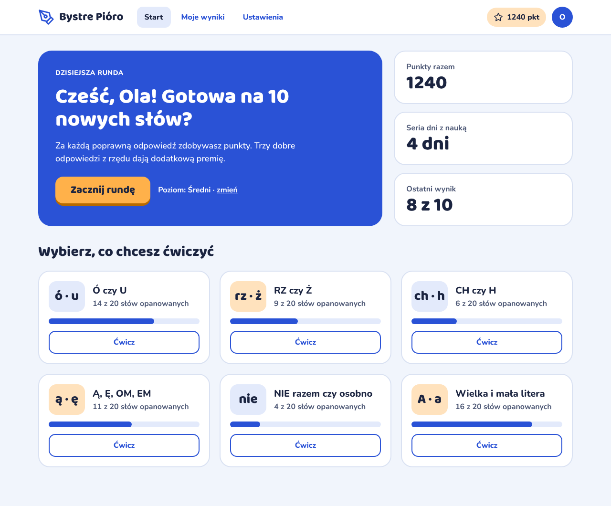
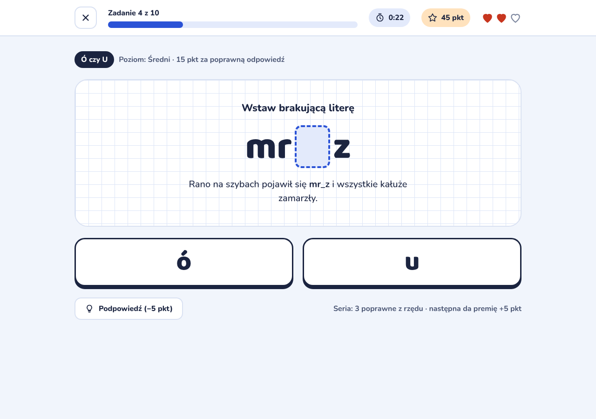
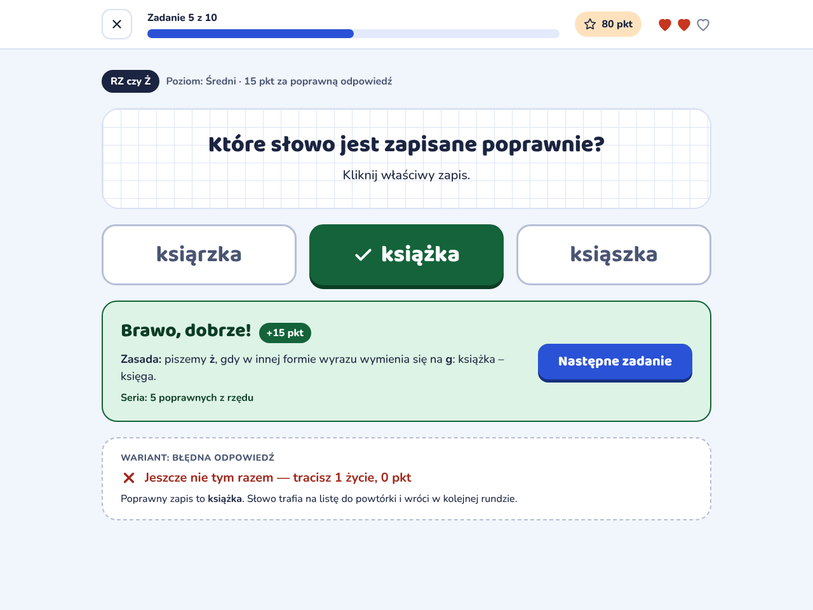
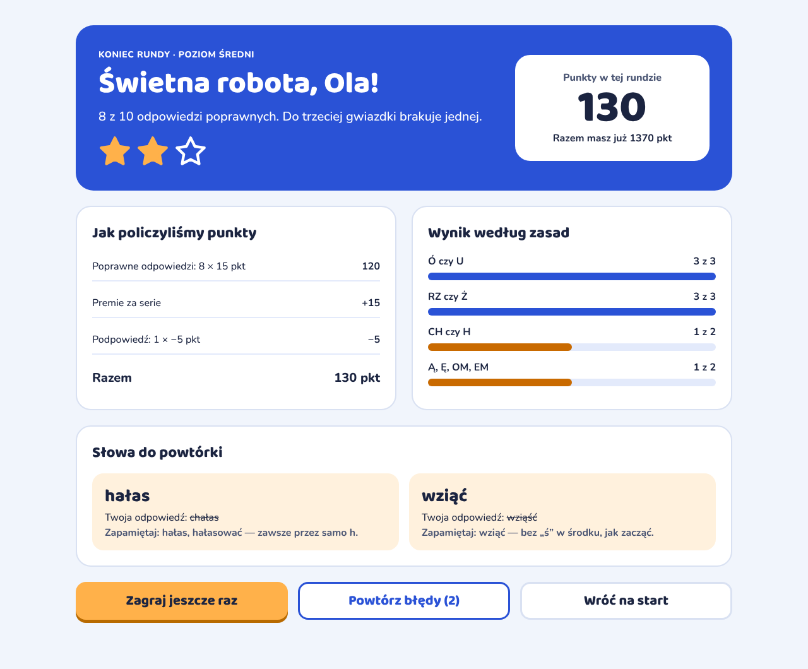
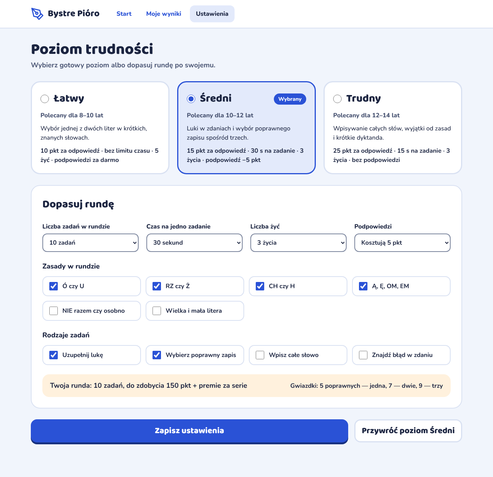

# Bystre Pióro — specyfikacja aplikacji do nauki ortografii

Dokument dla Claude Code. Opisuje aplikację przeglądarkową dla dzieci w wieku 8–14 lat do nauki polskiej ortografii: zadania, punktację, wyniki końcowe i panel ustawień poziomów trudności.

Stan wyjściowy: istnieje tylko projekt wyglądu (5 statycznych ekranów). Logiki jeszcze nie ma — to jest do zbudowania.

## Co jest w paczce

| Ścieżka | Zawartość |
|---|---|
| `SPEC.md` | ten dokument |
| `screens/*.png` | zrzuty każdego ekranu w szerokości 1280 px |
| `screens/*-telefon.png` | te same ekrany w szerokości 390 px |
| `mockups/*.html` | statyczne makiety HTML/CSS, źródło prawdy dla wyglądu (style są inline, można je przenosić 1:1) |

Makiety ładują kroje z Google Fonts, więc do poprawnego podglądu potrzebny jest internet.

**Uwaga o liczbach na makietach:** imię „Ola", punkty, serie i postępy są poglądowe i nie wszędzie zgadzają się ze sobą co do punktu. Obowiązują reguły z sekcji „Punktacja" poniżej, nie liczby ze zrzutów.

## Założenia techniczne

- Czysty HTML + CSS + JavaScript, bez frameworka i bez kroku budowania. Ma działać po otwarciu `index.html` oraz na GitHub Pages.
- Brak serwera i kont. Cały stan w `localStorage`.
- Jedna strona, ekrany przełączane w JS (routing po `location.hash`: `#start`, `#runda`, `#wyniki`, `#ustawienia`).
- Język interfejsu: polski. `<html lang="pl">`.
- Responsywność: układ płynny od 360 px do 1440 px, bez poziomego przewijania. Makiety osiągają to samym `flex-wrap` i `grid auto-fit`, bez media queries.
- Proponowana struktura plików:

```
index.html
css/style.css
js/app.js        # routing, stan, zapis do localStorage
js/game.js       # przebieg rundy, punktacja
js/tasks.js      # losowanie i budowanie zadań
js/settings.js   # poziomy i ustawienia własne
data/words.json  # baza słów
```

## Styl wizualny

Nazwa „Bystre Pióro" jest robocza.

### Kolory

| Rola | Wartość |
|---|---|
| Tło strony | `#F1F5FC` |
| Powierzchnia (karty, nagłówek) | `#FFFFFF` |
| Tekst główny | `#1B2440` |
| Tekst pomocniczy | `#4A5573` |
| Obramowania | `#D9E1F2` (mocniejsze: `#B5BFD6`, pola formularzy: `#7C869E`) |
| Akcent główny (niebieski) | `#2A52D6`, cień przycisku `#17307F` |
| Niebieski jasny (tła, tory pasków) | `#E3EAFB` |
| Akcent drugi (pomarańczowy) | `#FFB14A`, cień przycisku `#B86A00`, tekst na nim zawsze `#1B2440` |
| Pomarańczowy jasny | `#FFE2BD`, `#FFF1DD` |
| Pasek „do poprawy" | `#C96A00` |
| Poprawna odpowiedź | `#14633A`, cień `#0B3D23`, tło komunikatu `#DDF3E5` |
| Błędna odpowiedź | `#A1271A` |
| Życia (serca) | `#C7361F`, utracone: sam kontur `#7C869E` |

Stan poprawny/błędny nigdy nie jest sygnalizowany samym kolorem — zawsze jest też ikona (ptaszek / krzyżyk) i tekst.

### Typografia

- Nagłówki, liczby, przyciski główne, słowa w zadaniach: **Baloo 2** (600/700/800).
- Reszta: **Nunito** (500/700/800).
- Rozmiar bazowy 16 px, interlinia 1.5. Słowo w zadaniu: 5rem. Litery na przyciskach odpowiedzi: 3.5rem.
- Oba kroje muszą być ładowane z podzbiorem `latin-ext` (polskie znaki).

### Kształty i elementy

- Karty: promień 24–28 px, obramowanie 2 px. Przyciski: promień 14–22 px.
- Przyciski główne mają „wypukły" dolny cień (`box-shadow: 0 5px 0 <ciemniejszy>`), po wciśnięciu powinny się obniżać o 3–4 px.
- Pole z treścią zadania ma tło w kratkę zeszytową (klasa `.kratka` w makietach, kratka 28 px).
- Ikony: wyłącznie liniowe SVG inline (są w makietach). Bez emoji.
- Minimalny rozmiar celu dotyku: 44 px (w makietach 48 px i więcej).

## Ekrany

### 1. Start (`#start`)



Wersja na telefon: `screens/01-start-telefon.png`. Makieta: `mockups/01-start.html`.

- Nagłówek: logo, nawigacja (Start, Moje wyniki, Ustawienia), suma punktów, inicjał profilu.
- Blok powitalny: imię dziecka, przycisk **Zacznij rundę** (runda mieszana z zasad włączonych w ustawieniach), aktualny poziom z linkiem „zmień" prowadzącym do ustawień.
- Trzy kafelki: punkty razem, seria dni z nauką, ostatni wynik.
- Sześć kategorii. Każda pokazuje, ile słów z puli jest opanowanych, pasek postępu i przycisk **Ćwicz** (runda tylko z tej kategorii).

Kategorie: `ou` (Ó czy U), `rzz` (RZ czy Ż), `chh` (CH czy H), `nosowe` (Ą, Ę, OM, EM), `nie` (NIE razem czy osobno), `wielka` (Wielka i mała litera).

Przy pierwszym uruchomieniu aplikacja pyta o imię (jedno pole) i zapisuje je. „Moje wyniki" w pierwszej wersji może pokazywać prostą listę ostatnich 10 rund — ten ekran nie ma makiety.

### 2. Zadanie — uzupełnij lukę (`#runda`)



Wersja na telefon: `screens/02-zadanie-luka-telefon.png`. Makieta: `mockups/02-zadanie-luka.html`.

- Pasek rundy: przycisk zamknięcia (pyta o potwierdzenie, przerwana runda nie zapisuje punktów), „Zadanie X z N" z paskiem postępu, licznik czasu (ukryty, gdy bez limitu), punkty rundy, życia (ukryte, gdy bez limitu).
- Etykieta kategorii i informacja o poziomie i stawce punktów.
- Karta zadania: polecenie, słowo z luką, zdanie z tym słowem w kontekście.
- Przyciski odpowiedzi: po jednym na każdą możliwą literę lub zbitkę (np. `ó` / `u`).
- Przycisk **Podpowiedź** z kosztem; obok bieżąca seria.

### 3. Zadanie — po odpowiedzi



Wersja na telefon: `screens/03-zadanie-po-odpowiedzi-telefon.png`. Makieta: `mockups/03-zadanie-po-odpowiedzi.html`.

Ten ekran pokazuje drugi typ zadania („wybierz poprawny zapis" spośród trzech) oraz stan po udzieleniu odpowiedzi.

- Po kliknięciu odpowiedzi przyciski się blokują. Poprawna zaznacza się na zielono z ptaszkiem.
- Pod spodem pojawia się panel z wynikiem: komunikat, przyznane punkty, **zasada ortograficzna** wyjaśniająca zapis, bieżąca seria, przycisk **Następne zadanie**.
- Przy błędnej odpowiedzi: wybrany przycisk zaznacza się na czerwono z krzyżykiem, poprawny dodatkowo na zielono, a panel ma treść z ramki „Wariant: błędna odpowiedź" (utrata życia, 0 pkt, poprawny zapis, zasada). Ramka z napisem „Wariant…" jest tylko notatką projektową — w aplikacji jej nie ma, panel błędu zastępuje panel sukcesu.
- Panel ma `aria-live="polite"`. Klawisz Enter uruchamia „Następne zadanie".

### 4. Wyniki końcowe (`#wyniki`)



Wersja na telefon: `screens/04-wyniki-telefon.png`. Makieta: `mockups/04-wyniki.html`.

- Podsumowanie: poziom, komunikat zależny od wyniku, liczba poprawnych, gwiazdki (0–3), punkty rundy i nowa suma punktów.
- „Jak policzyliśmy punkty": rozbicie na odpowiedzi, premie za serie, koszt podpowiedzi, razem.
- „Wynik według zasad": poprawne / wszystkie dla każdej kategorii, która wystąpiła. Pasek niebieski przy 100%, pomarańczowy poniżej.
- „Słowa do powtórki": każde błędne słowo z poprawnym zapisem, odpowiedzią dziecka (przekreśloną) i krótką wskazówką. Gdy błędów nie było, w tym miejscu jest gratulacja.
- Przyciski: **Zagraj jeszcze raz** (te same ustawienia), **Powtórz błędy (n)** (runda tylko z błędnych słów, ukryty przy braku błędów), **Wróć na start**.

Komunikaty: 3 gwiazdki „Mistrzowska runda!", 2 „Świetna robota!", 1 „Dobry początek!", 0 „Spróbuj jeszcze raz — będzie lepiej!". Ton zawsze zachęcający, bez zawstydzania.

### 5. Ustawienia poziomów trudności (`#ustawienia`)



Wersja na telefon: `screens/05-ustawienia-telefon.png`. Makieta: `mockups/05-ustawienia.html`.

- Trzy gotowe poziomy jako karty z polem radio.
- „Dopasuj rundę": cztery listy wyboru, pola wyboru zasad, pola wyboru rodzajów zadań.
- Pasek podsumowania przelicza się na żywo: liczba zadań × stawka = maksimum punktów.
- **Zapisz ustawienia** zapisuje do `localStorage` i pokazuje krótkie potwierdzenie. **Przywróć poziom …** cofa zmiany własne do wartości wybranego gotowego poziomu.
- Wybór gotowego poziomu ustawia wszystkie pola poniżej na jego wartości. Zmiana dowolnego pola ręcznie zostawia zaznaczony poziom bazowy (od niego zależy stawka punktów i pula słów), a przy nazwie pojawia się dopisek „zmieniony".
- Musi zostać zaznaczona co najmniej jedna zasada i co najmniej jeden rodzaj zadania — inaczej zapis jest zablokowany z komunikatem.

## Poziomy trudności

| | Łatwy | Średni | Trudny |
|---|---|---|---|
| Polecany wiek | 8–10 lat | 10–12 lat | 12–14 lat |
| Punkty za poprawną odpowiedź | 10 | 15 | 25 |
| Czas na zadanie | bez limitu | 30 s | 15 s |
| Życia | 5 | 3 | 3 |
| Podpowiedzi | za darmo | −5 pkt | wyłączone |
| Liczba zadań | 10 | 10 | 10 |
| Rodzaje zadań | uzupełnij lukę | luka, wybierz zapis | luka, wybierz zapis, wpisz słowo, znajdź błąd |
| Zasady domyślnie | ó/u, rz/ż, ch/h | + ą/ę/om/em | wszystkie sześć |
| Pula słów | `poziom: 1` | `poziom: 1–2` | `poziom: 1–3` |

Opcje list wyboru:

- Liczba zadań: 5, 10, 15, 20.
- Czas na zadanie: bez limitu, 45 s, 30 s, 15 s.
- Liczba żyć: bez limitu, 5, 3, 1.
- Podpowiedzi: za darmo, kosztują 5 pkt, wyłączone.

Domyślny poziom przy pierwszym uruchomieniu: Średni.

## Rodzaje zadań

1. **Uzupełnij lukę** (`luka`) — słowo z jedną luką i zdanie; odpowiedź przyciskiem z literą lub zbitką. Opcje wynikają z kategorii (`ó`/`u`, `rz`/`ż`, `ch`/`h`, `ą`/`om`/`on`, `ę`/`em`/`en`, razem/osobno, wielka/mała).
2. **Wybierz poprawny zapis** (`wybor`) — trzy warianty tego samego słowa, jeden poprawny; kolejność losowa.
3. **Wpisz całe słowo** (`wpisz`) — zdanie z całym słowem zastąpionym polem tekstowym i podaną pierwszą literą; porównanie bez rozróżniania wielkości liter (poza kategorią `wielka`) i po przycięciu spacji.
4. **Znajdź błąd w zdaniu** (`blad`) — zdanie, w którym każde słowo jest przyciskiem; jedno jest zapisane błędnie i trzeba je kliknąć.

Typy 3 i 4 nie mają makiet. Mają używać tej samej karty w kratkę, tego samego paska rundy i tego samego panelu po odpowiedzi co typy 1 i 2.

**Podpowiedź** pokazuje zasadę lub wskazówkę do słowa (pole `podpowiedz`), nie ujawniając wprost odpowiedzi. Jedna na zadanie.

## Przebieg rundy

1. Losowanie N słów bez powtórzeń z puli zgodnej z poziomem i włączonymi zasadami. Słowa z listy „do powtórki" mają pierwszeństwo (do połowy rundy). Dla każdego słowa losowany jest rodzaj zadania spośród włączonych i obsługiwanych przez to słowo.
2. Zadanie → odpowiedź → panel z wynikiem i zasadą → „Następne zadanie".
3. Upływ czasu liczy się jak błędna odpowiedź. Licznik zatrzymuje się po udzieleniu odpowiedzi; ostatnie 5 sekund jest wyróżnione.
4. Błąd odbiera jedno życie i zeruje serię. Gdy życia spadną do zera, runda kończy się od razu i przechodzi do wyników (pozostałe zadania liczą się jako nieudzielone).
5. Po ostatnim zadaniu: ekran wyników, zapis rundy.

Gdy w puli jest mniej słów niż N, runda jest odpowiednio krótsza.

## Punktacja

- Poprawna odpowiedź: stawka poziomu (10 / 15 / 25 pkt).
- Błędna odpowiedź lub upływ czasu: 0 pkt.
- **Premia za serię:** +5 pkt za każdą trzecią poprawną odpowiedź z rzędu (seria osiąga 3, 6, 9…). Błąd zeruje serię.
- Podpowiedź: koszt wg ustawień (0 lub 5 pkt), odejmowany w chwili użycia. Wynik rundy nie spada poniżej 0.
- Wynik rundy = odpowiedzi + premie − podpowiedzi. Dodawany do sumy punktów profilu dopiero po ukończeniu rundy.
- **Gwiazdki** wg odsetka poprawnych odpowiedzi w rundzie: co najmniej 50% — jedna, 70% — dwie, 90% — trzy.
- **Słowo opanowane:** dwie poprawne odpowiedzi z rzędu w różnych rundach. Błąd cofa licznik słowa do zera i dodaje je do listy „do powtórki"; poprawna odpowiedź usuwa je z tej listy.
- **Seria dni:** liczba kolejnych dni kalendarzowych z co najmniej jedną ukończoną rundą.

## Dane

### Baza słów — `data/words.json`

```json
[
  {
    "id": "mroz",
    "slowo": "mróz",
    "kategoria": "ou",
    "poziom": 1,
    "luka": { "przed": "mr", "po": "z", "odpowiedz": "ó", "opcje": ["ó", "u"] },
    "bledne": ["mruz", "mrós"],
    "zdanie": "Rano na szybach pojawił się ___ i wszystkie kałuże zamarzły.",
    "zasada": "Piszemy ó, gdy w innej formie wyrazu wymienia się na o: mróz – mrozy.",
    "podpowiedz": "Pomyśl, jak brzmi to słowo w liczbie mnogiej."
  },
  {
    "id": "ksiazka",
    "slowo": "książka",
    "kategoria": "rzz",
    "poziom": 2,
    "luka": { "przed": "ksią", "po": "ka", "odpowiedz": "ż", "opcje": ["ż", "rz"] },
    "bledne": ["ksiąrzka", "ksiąszka"],
    "zdanie": "Na półce stała gruba ___ o podróżach.",
    "zasada": "Piszemy ż, gdy w innej formie wyrazu wymienia się na g: książka – księga.",
    "podpowiedz": "Poszukaj wyrazu pokrewnego, w którym słychać g."
  }
]
```

- `bledne` — dokładnie dwa błędne zapisy do zadania „wybierz poprawny zapis"; mają odwzorowywać typowe błędy dzieci.
- `zdanie` — `___` oznacza miejsce słowa. Do zadania „znajdź błąd" aplikacja wstawia w to miejsce jeden z błędnych zapisów.
- Słowo może nie mieć pola `luka` (np. w kategorii `nie`, gdzie opcje to „razem" / „osobno") — wtedy definiuje `opcje` i `odpowiedz` na najwyższym poziomie obiektu.
- **Do przygotowania:** co najmniej 20 słów na kategorię (120 łącznie), rozłożonych na trzy poziomy. Poziom 1: słowa częste z regularną zasadą. Poziom 2: mniej oczywiste wymiany i wyrazy do zapamiętania. Poziom 3: wyjątki i pułapki. Każde hasło i każda zasada muszą zostać sprawdzone ze słownikiem ortograficznym — błąd w bazie uczy dziecko błędu.

### Stan — `localStorage`, klucz `bystrePioro.v1`

```json
{
  "profil": { "imie": "Ola", "punkty": 1240, "seriaDni": 4, "ostatniDzien": "2026-10-09" },
  "ustawienia": {
    "poziom": "sredni",
    "liczbaZadan": 10,
    "czasNaZadanie": 30,
    "zycia": 3,
    "podpowiedzi": "platne",
    "kategorie": ["ou", "rzz", "chh", "nosowe"],
    "rodzajeZadan": ["luka", "wybor"]
  },
  "slowa": { "mroz": { "poprawneZRzedu": 2, "doPowtorki": false } },
  "historia": [
    { "data": "2026-10-09T16:20:00", "poziom": "sredni", "poprawne": 8, "zadania": 10, "punkty": 130, "gwiazdki": 2 }
  ]
}
```

`czasNaZadanie` i `zycia` przyjmują `null` dla „bez limitu". `podpowiedzi`: `"darmowe"`, `"platne"`, `"wylaczone"`. Historia przechowuje ostatnie 50 rund. Odczyt i zapis w `try/catch` — aplikacja ma działać także wtedy, gdy `localStorage` jest niedostępny (wtedy stan żyje tylko w pamięci).

## Dostępność i wygoda

- Prawdziwe elementy `<button>`, `<a>`, `<input>` z `<label>`, `<select>`, `<fieldset>` z `<legend>` — tak jak w makietach.
- Pełna obsługa z klawiatury: Tab i Enter wszędzie; w zadaniach z wyborem dodatkowo klawisze 1, 2, 3.
- Widoczny obrys fokusu (3 px, `#1B2440`, odsunięty o 2 px).
- Po przejściu do nowego zadania fokus trafia na polecenie zadania.
- Kontrast tekstu co najmniej 4.5:1 (paleta powyżej to spełnia).
- Animacje krótkie (do 200 ms) i wyłączane przy `prefers-reduced-motion`.
- Bez dźwięku w pierwszej wersji.

## Kryteria odbioru

1. Aplikacja uruchamia się z `index.html` bez serwera i bez błędów w konsoli.
2. Pięć ekranów wygląda jak na zrzutach przy 1280 px i 390 px.
3. Da się przejść pełną rundę na każdym z trzech poziomów; czas, życia i podpowiedzi działają zgodnie z tabelą poziomów.
4. Punkty, premie i gwiazdki na ekranie wyników zgadzają się z regułami z sekcji „Punktacja", a rozbicie sumuje się do wyniku.
5. Zmiana ustawień jest zapamiętana po odświeżeniu strony i wpływa na następną rundę.
6. Błędne słowa trafiają do „Słów do powtórki" i wracają w kolejnej rundzie; „Powtórz błędy" tworzy rundę tylko z nich.
7. Postęp kategorii na ekranie Start rośnie wraz z opanowanymi słowami.
8. Brak poziomego przewijania przy 360 px.

## Kolejność prac

1. Szkielet: `index.html`, `style.css` z tokenami z sekcji „Styl wizualny", routing po hashu, nagłówek.
2. Przeniesienie pięciu makiet do widoków (HTML z `mockups/` jako punkt wyjścia), wspólne style wyciągnięte do klas.
3. Stan i `localStorage`, ekran ustawień w pełni działający.
4. Baza słów: format, po 5 słów na kategorię na start.
5. Runda z zadaniami `luka` i `wybor`, punktacja, ekran wyników.
6. Lista do powtórki, postęp kategorii, seria dni, historia rund.
7. Zadania `wpisz` i `blad`.
8. Rozbudowa bazy do 120 słów z weryfikacją każdej pozycji.
9. Przejście po kryteriach odbioru, test na telefonie.
